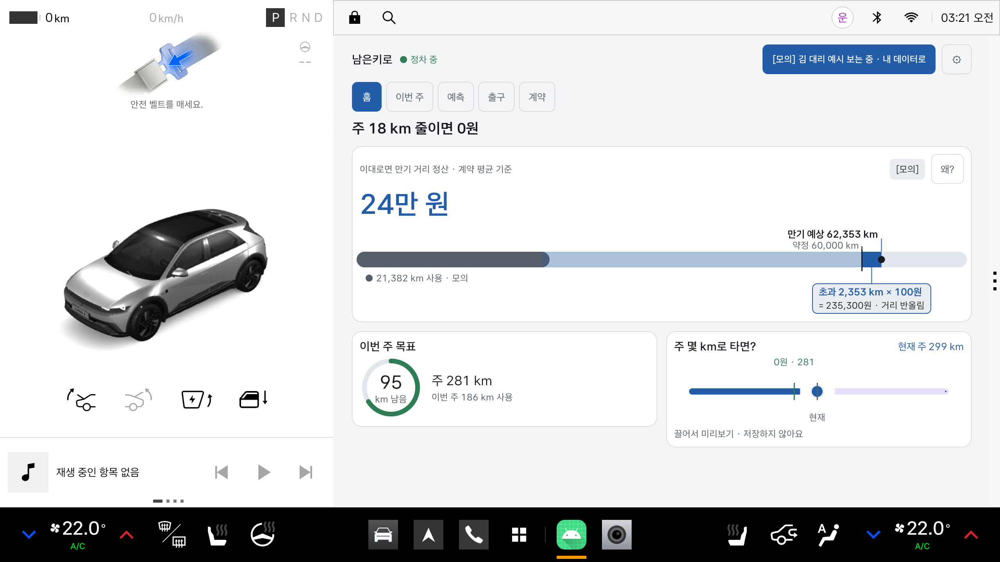
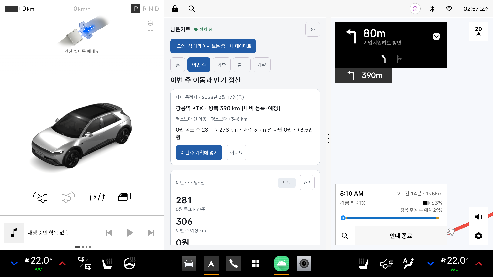
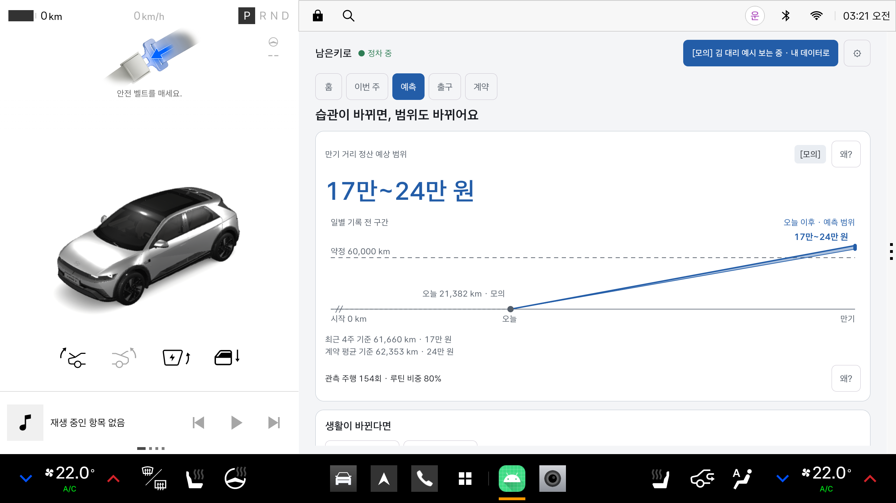
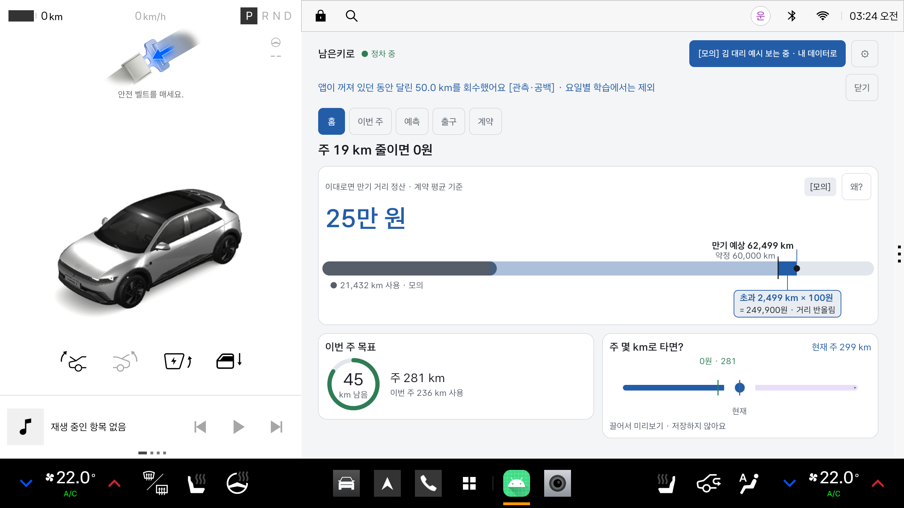
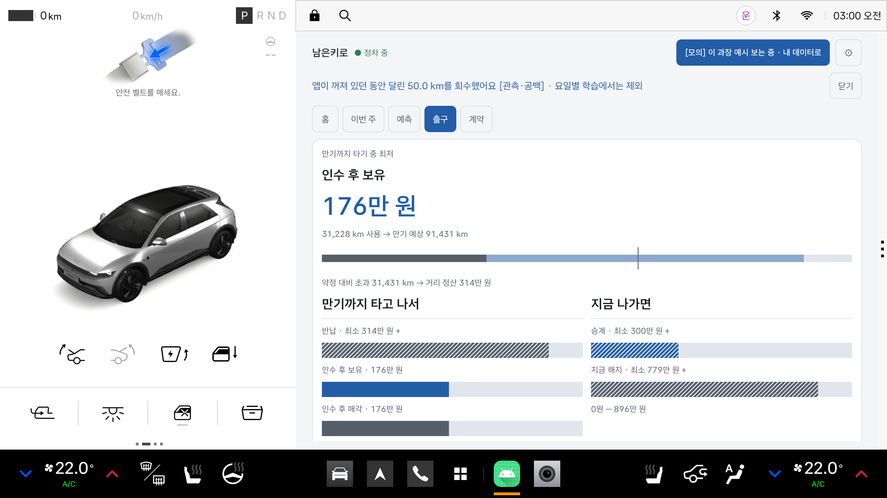

# 남은키로

> 장기렌트·리스 약정거리를 **"이번 주 몇 km까지 타면 만기 초과 정산 0원인지"**와 **"지금 습관이면 만기에 얼마를 내는지"**로 바꿔 보여 주는 Pleos Connect 차량용 페이스메이커 앱

팀: **성원이와 아이들** · 2026 현대자동차그룹 차량용 앱 개발 공모전 출품작



계기판 누적거리(Pleos Vehicle SDK)를 받아 만기 예상 거리와 초과 정산액을 계산합니다. 순정 내비에 목적지를 넣으면(NaviHelper) 그 이동이 만기 비용을 얼마나 바꾸는지 카드로 알려 줍니다. 주행 중(기어 D·CarUxRestrictions)에는 숫자 없는 잠금 화면만 보여 줍니다. 이미 많이 탄 사람에게는 인수·승계·해지 비교를, 덜 타는 사람에게는 다음 계약 약정 추천을 보여 줍니다.

- 최종 명세: [docs/FINAL_SPEC.md](docs/FINAL_SPEC.md)
- 계산 설명: [docs/FEATURE_GUIDE.md](docs/FEATURE_GUIDE.md) · 개발 계획·시연 대본: [docs/DEV_PLAN.md](docs/DEV_PLAN.md)
- 에뮬레이터 리허설 결과: [docs/rehearsal/final/REPORT.md](docs/rehearsal/final/REPORT.md)

---

## 1. 앱 이름과 한 줄 소개

| 항목 | 내용 |
|---|---|
| 앱 이름 | 남은키로 (패키지 `com.namunkiro`) |
| 한 줄 소개 | 장기렌트·리스 약정거리 초과 정산을 매주 목표 페이스와 만기 비용으로 보여 주는 차량용 앱 |
| 사용 SDK | Pleos Vehicle SDK 2.3.2(누적 주행거리·기어), NaviHelper 3.0.5(순정 내비 목적지), AAOS CarUxRestrictionsManager(주행 중 화면 제한) |

## 2. 실행 방법

### 2.1 APK 설치

APK 위치: [`apk/성원이와 아이들_남은키로_release.apk`](apk/)

```sh
# Pleos Connect 에뮬레이터를 cold boot로 켠 뒤
adb install -r "apk/성원이와 아이들_남은키로_release.apk"
# 앱은 사용자 10으로 실행된다(--user 10)
adb shell am start --user 10 -n com.namunkiro/.app.MainActivity
```

에뮬레이터 런처에서 **남은키로** 아이콘을 눌러도 됩니다. 부팅 직후 처음 실행할 때 순정 내비가 앞에 남으면 한 번 더 실행하세요.

### 2.2 데모 모드 진입

1. 첫 화면에서 **[▶ 예시로 둘러보기 [모의] · 김 대리 · 만기 약 24만 원]**을 누릅니다.
2. 김 대리(계약 501일 차) 예시가 열립니다. 홈에 "주 18 km 줄이면 0원", 히어로 **24만 원**, 막대 말풍선 "초과 2,353 km × 100원 = 235,300원"이 보입니다.
3. 상단 탭 **홈 · 이번 주 · 예측 · 출구 · 계약**을 둘러봅니다. 숫자 옆 **[왜?]**를 누르면 산식과 가정이 나옵니다.
4. 예시를 끝내려면 헤더 칩 **"[모의] 김 대리 예시 보는 중 · 내 데이터로"**를 누릅니다.

- 예시 데이터(계약·과거 주행 이력·날짜)는 화면에 **[모의]**로 표시됩니다. 계산은 실제 앱 코드 그대로입니다.
- 시연 설정 패널(헤더 ⚙: 인물 4명 전환, 날짜 이동, 모의/실제 차량 전환, 가짜 내비 목적지)은 제출용 release APK에도 포함되어 있습니다(`BuildConfig.DEMO_PANEL=true`). [예시로 둘러보기] 후 헤더 ⚙에서 인물을 바꿔 출구·보험·여유 장면을 볼 수 있습니다.
- 내 계약으로 쓰려면 **[내 계약으로 시작]**에서 만기일·총 약정거리·초과 단가 3가지를 넣습니다. 시작 계기판은 차량 값으로 자동으로 채워집니다.

### 2.3 빌드 방법

```sh
cd android
./gradlew assembleRelease          # release APK → app/build/outputs/apk/release/
./gradlew :app:assembleDebug       # 시연 설정 패널 포함 debug APK
./gradlew :app:testDebugUnitTest   # 단위 테스트(74개)
```

- 필요 환경: JDK 17, Android SDK(compileSdk 37 / targetSdk 35 / minSdk 28). Gradle wrapper가 Gradle 9.6.0을 받습니다(AGP 9.5.1, Kotlin 2.2.10).
- Pleos SDK는 `ai.pleos.playground` Maven 저장소에서 받습니다(`android/settings.gradle.kts`에 설정됨).
- 제출 APK는 팀 release 키로 서명되어 있어 바로 설치할 수 있습니다. 서명 키와 비밀번호(`android/keystore.properties`)는 저장소에 포함하지 않으며, 파일이 없으면 `assembleRelease` 결과물은 서명되지 않습니다(직접 빌드할 때는 `assembleDebug` 또는 자체 키 사용).

## 3. 테스트 환경 및 필요한 설정

### 3.1 테스트 환경

| 항목 | 값 |
|---|---|
| 에뮬레이터 | Android Studio AVD **Pleos_Connect v2.1.0**(Automotive, Android 14 / API 34) |
| 화면 규격 | **2560 × 1440, density 160**. 앱 영역 약 1682 × 1210dp, 반쪽 창 약 840dp(1열 배치) |
| AVD 설정 | Boot = **Cold**(quick boot면 VHAL 사용 불가), `-no-snapshot` 권장, RAM 2~4GB |
| 순정 내비 | `ai.umos.maps.android.navigation.app`, 내비 서비스 3.0.4 |

### 3.2 권한

Manifest에 선언만 하면 되고, 실행 중 권한 팝업은 없습니다. **인터넷 권한은 쓰지 않으며 모든 데이터는 기기 안에만 저장합니다.**

| 권한 | 용도 |
|---|---|
| `pleos.car.permission.CAR_DRIVE` | 누적 주행거리(Odometer)·기어 |
| `pleos.car.permission.NAVI_ROUTE` | 순정 내비 목적지·경로 상태 조회(NaviHelper) |
| `android.hardware.type.automotive`(uses-feature) | 차량 전용 앱 |
| `distractionOptimized=true`(activity meta-data) | 주행 중 최소 잠금 화면을 앱이 직접 표시 |

### 3.3 Virtual Console(VC) 사용법

VC는 에뮬레이터의 차량 상태를 바꾸는 웹 콘솔입니다.

```sh
adb forward tcp:8088 tcp:8088
# PC 브라우저에서 http://127.0.0.1:8088/ 열기
```

| 확인할 동작 | VC 조작 | 앱에서 보이는 것 |
|---|---|---|
| 실제 주행거리 반영 | 주행거리(Odometer)를 몇 km 올림 | "+5 km → +500원 · 관측" 칩, 막대·목표 갱신(약 1~3초) |
| 주행 잠금 | 기어 **D** → 다시 **P** | "주행 중에는 화면을 쉬어 갑니다" → 보던 화면 복원 |
| 공백 회수(시동 재시작 대신) | `adb shell am force-stop --user 10 com.namunkiro` → 주행거리 +50 → 앱 재실행 | "앱이 꺼져 있던 동안 달린 50.0 km를 회수했어요 [관측·공백]" |
| 급증 보류 | 주행거리를 한 번에 수백 km 올림 | "계기판 값이 크게 바뀌었어요 · 주행으로 세지 않았어요" |
| 내비 목적지 제안 | 앱을 반쪽 창으로 두고 순정 내비에서 목적지 안내 시작 | "<목적지> · 왕복 N km · 평소보다 +N km · +N만 원" 카드 |

- VC 주행거리는 **늘리기만** 할 수 있습니다(줄이기 불가).
- 콜드 부팅 직후 VC 주행거리는 0 km입니다. **내 계약**을 먼저 만든 뒤 주행거리를 크게 올리면 급증 보류가 뜨며, [새 기준으로]를 눌러 이어갈 수 있습니다.
- 브라우저 없이 쓸 때: `POST /browser/session?client=<id>`를 1초마다 보내는 동안 `PUT /vehicle/odometer?traveled_distance_km=<km>`, `PUT /vehicle/gear?gear=Park|Drive`가 동작합니다(`docs/PLATFORM_NOTES.md` 9절).
- 반쪽 창: 앱 영역 오른쪽 핸들을 왼쪽으로 끌면 내비와 나란히 표시됩니다. 내비가 앱을 완전히 가리면 이벤트는 앱이 다시 보일 때 한꺼번에 들어옵니다.

## 4. 개발에 사용한 Pleos Connect 에뮬레이터 버전과 화면 규격

| 항목 | 값 |
|---|---|
| 에뮬레이터 버전 | **Pleos_Connect v2.1.0** (Pleos Connect system image, API 34) |
| 화면 규격 | **2560 × 1440, density 160** |

## 5. APK 위치

**[`apk/성원이와 아이들_남은키로_release.apk`](apk/)**

---

## 스크린샷

에뮬레이터(Pleos_Connect v2.1.0)에서 캡처했습니다. 전체 목록과 설명: [docs/rehearsal/final/REPORT.md](docs/rehearsal/final/REPORT.md)

| 첫 실행 | 실제 SDK +5 km |
|---|---|
|  |  |
| **순정 내비 목적지 → 제안 카드** | **제안 수락 후 이번 주** |
|  |  |
| **예측 범위** | **주행 잠금(기어 D)** |
|  |  |
| **공백 회수** | **출구 비교(이 과장)** |
|  |  |
| **덜 타는 사람(정 주임)** | **급증 보류** |
|  |  |

## 저장소 구조

```
android/   Android Studio 프로젝트(Kotlin, Jetpack Compose)
  app/src/main/java/com/namunkiro/
    vehicle/  Pleos Vehicle·NaviHelper 게이트웨이, 가짜 차량
    domain/   계기판 수집기, 주간 페이스·예측·출구·보험·주행 패턴 엔진
    ui/v2/    현재 화면(홈·이번 주·예측·출구·계약), CostModel
    app/      AppViewModel, TripSegmenter, MainActivity
    demo/     시연 인물 시드·데모 패널
apk/       제출용 release APK
design/    디자인 토큰·화면 명세·목업
docs/      최종 명세, 기능 설명, 개발 계획, 플랫폼 실측, 리허설 캡처
```
