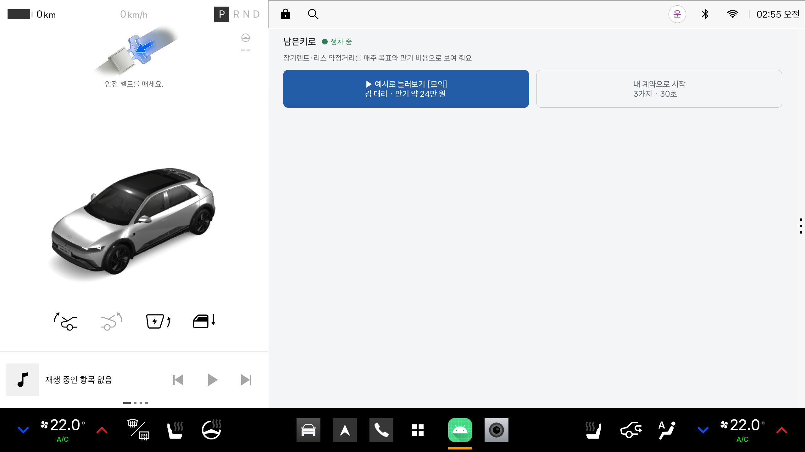
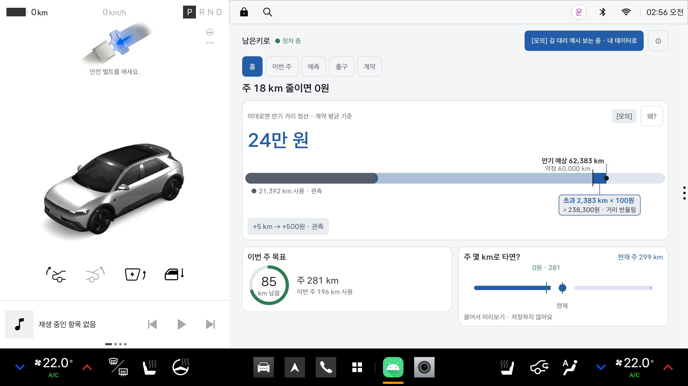
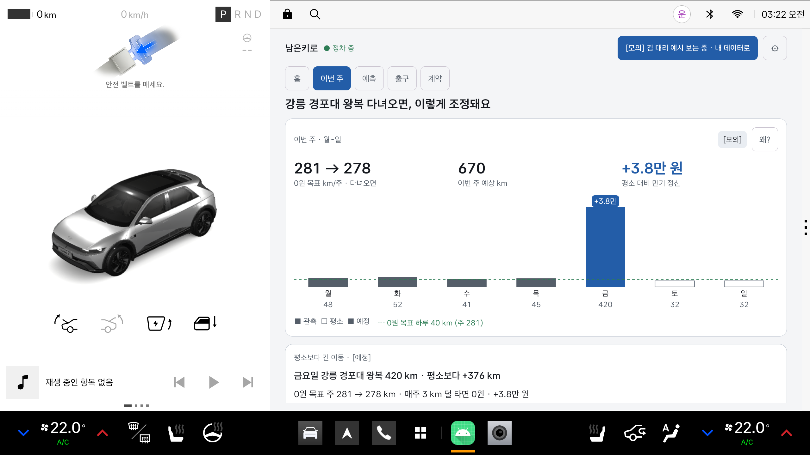
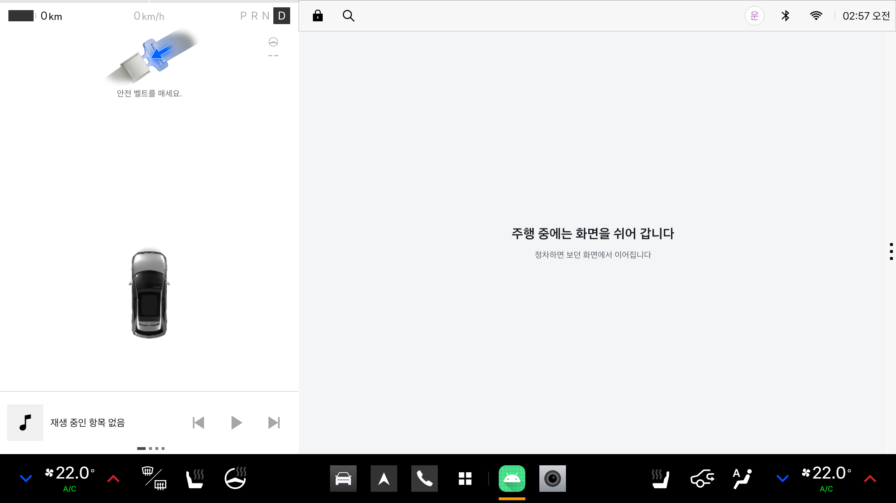
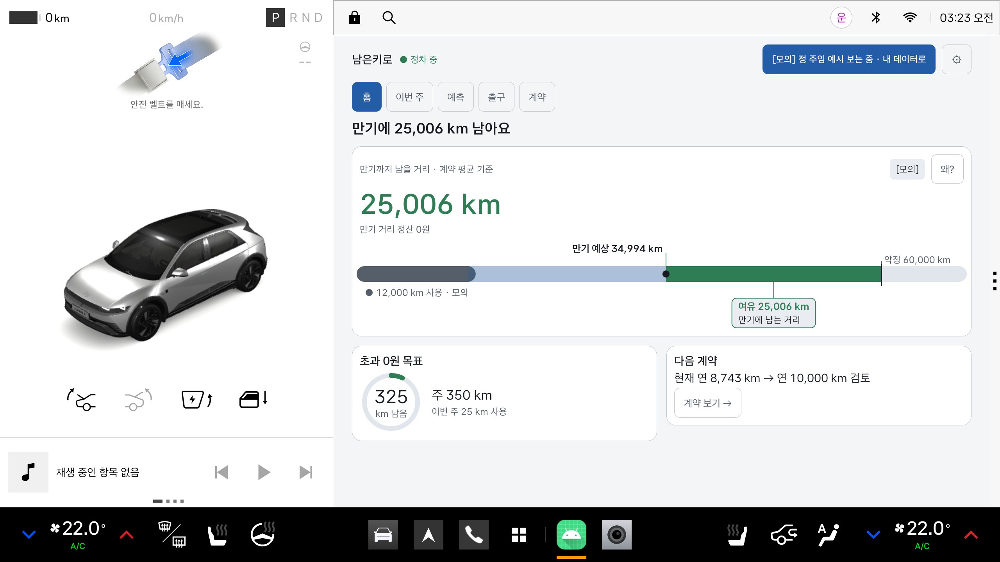
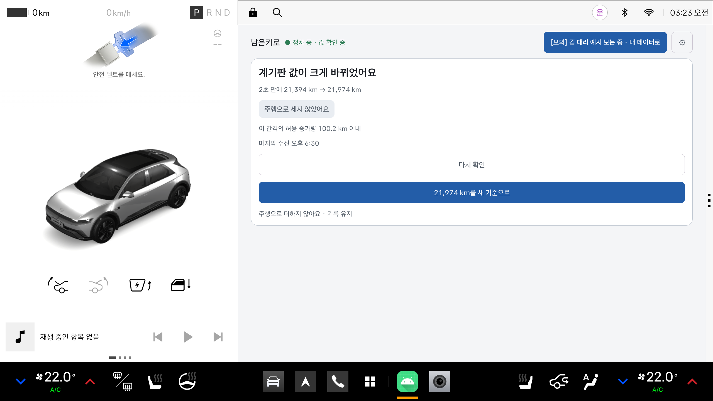

# 남은키로

> 장기렌트·리스 약정거리를 "이번 주 몇 km까지 타면 만기 초과 정산 0원인지"와 "지금 습관이면 만기에 얼마를 내는지"로 바꿔 보여 주는 Pleos Connect 차량용 페이스메이커 앱

팀: **성원이와 아이들** · 2026 현대자동차그룹 차량용 앱 개발 공모전 출품작

| 바로가기 | |
|---|---|
| 📦 APK | [`apk/성원이와 아이들_남은키로_release.apk`](apk/%EC%84%B1%EC%9B%90%EC%9D%B4%EC%99%80%20%EC%95%84%EC%9D%B4%EB%93%A4_%EB%82%A8%EC%9D%80%ED%82%A4%EB%A1%9C_release.apk) (서명된 release, 버전 0.1.0, 시연 패널 포함) · [Releases](../../releases) |
| 🎬 시연 영상 | [`demo/namunkiro-demo-90s.mp4`](demo/namunkiro-demo-90s.mp4) (1분 26초, 에뮬레이터 실제 화면 녹화) |
| 🖥 테스트 환경 | Pleos_Connect v2.1.0 에뮬레이터 · 2560 × 1440, density 160 · Virtual Console |
| ▶ 30초 체험 | 설치 → **[예시로 둘러보기]** → 탭 5개 → 헤더 ⚙에서 인물 전환 ([2.2](#22-데모-모드-진입)) |
| 📄 문서 | [최종 명세](docs/FINAL_SPEC.md) · [계산 설명](docs/FEATURE_GUIDE.md) · [리허설 결과](docs/rehearsal/final/REPORT.md) · [release 실기 검증](docs/rehearsal/final/RELEASE_CHECK.md) |


## 왜 필요한가, 왜 차 안인가

장기렌트·운용리스는 계약할 때 정한 약정거리를 넘기면 만기에 km당 초과 정산금(국산차 기준 보통 100~200원/km)을 냅니다. 그런데 이용자는 계약서를 다시 보지 않고, 만기 1~2년 전에는 "얼마나 넘을지"를 알 방법이 없습니다. 많이 탄 사람은 손쓸 수 있는 시점을 놓치고, 덜 탄 사람은 다음 계약에서도 약정을 과하게 잡습니다.

남은키로는 이 계산을 **매일 타는 차의 화면**으로 옮깁니다.

- **입력 없는 집계**: 계기판 누적거리(Pleos Vehicle SDK)를 직접 받습니다. 가족이 운전했거나 앱이 꺼져 있던 동안의 주행도 다음 실행 때 누적거리 차이로 회수합니다. 폰 앱은 이 값을 알 수 없습니다.
- **목적지가 곧 계획**: 순정 내비에 목적지를 넣으면(NaviHelper) 그 이동이 만기 비용을 얼마나 바꾸는지 카드로 알려 주고, 한 번에 이번 주 계획에 넣습니다.
- **주행 안전**: 기어 D·CarUxRestrictions에서는 숫자 없는 잠금 화면만 보여 주고, P로 돌아오면 보던 화면을 이어 줍니다.
- **출구와 다음 계약**: 이미 많이 탄 사람에게는 인수·승계·해지 비교를, 덜 타는 사람에게는 다음 계약 약정 추천을 보여 줍니다.

---

## 1. 앱 이름과 한 줄 소개

| 항목 | 내용 |
|---|---|
| 앱 이름 | 남은키로 (패키지 `com.namunkiro`) |
| 한 줄 소개 | 장기렌트·리스 약정거리 초과 정산을 매주 목표 페이스와 만기 비용으로 보여 주는 차량용 앱 |
| 사용 SDK | Pleos Vehicle SDK 2.3.2(누적 주행거리·기어), NaviHelper 3.0.5(순정 내비 목적지), AAOS CarUxRestrictionsManager(주행 중 화면 제한) |

## 2. 실행 방법

### 2.1 APK 설치

APK 위치: [`apk/성원이와 아이들_남은키로_release.apk`](apk/)

```sh
# Pleos Connect 에뮬레이터를 cold boot로 켠 뒤
adb install -r "apk/성원이와 아이들_남은키로_release.apk"
# 앱은 사용자 10으로 실행된다(--user 10)
adb shell am start --user 10 -n com.namunkiro/.app.MainActivity
```

에뮬레이터 런처에서 **남은키로** 아이콘을 눌러도 됩니다. 부팅 직후 처음 실행할 때 순정 내비가 앞에 남으면 한 번 더 실행하세요.

### 2.2 데모 모드 진입

1. 첫 화면에서 **[▶ 예시로 둘러보기 [모의] · 김 대리 · 만기 약 24만 원]**을 누릅니다.
2. 김 대리(계약 501일 차) 예시가 열립니다. 홈에 "주 18 km 줄이면 0원", 히어로 **24만 원**, 막대 말풍선 "초과 2,353 km × 100원 = 235,300원"이 보입니다.
3. 상단 탭 **홈 · 이번 주 · 예측 · 출구 · 계약**을 둘러봅니다. 숫자 옆 **[왜?]**를 누르면 산식과 가정이 나옵니다. 출구 탭에서 "인수가와 예상 시세" 입력 시트가 뜨면 **[나중에]**로 닫고 둘러봐도 됩니다.
4. 헤더 **⚙(시연 설정)**에서 인물을 바꿉니다: **이 과장**(1년 4개월 차, 출구 비교·출구 달력), **이 과장 90일**(페이스 회복 어려움), **정 주임**(덜 타는 사람, 다음 계약 추천), **박 과장**(보험 마일리지 특약 모드).
5. 예시를 끝내려면 헤더 칩 **"[모의] 김 대리 예시 보는 중 · 내 데이터로"**를 누릅니다. 이때 에뮬레이터 계기판 값이 크게 달라 급증 보류 카드가 먼저 뜰 수 있으며, [새 기준으로]를 누르면 이어집니다.

- 예시 데이터(계약·과거 주행 이력·날짜)는 화면에 **[모의]**로 표시됩니다. 계산은 실제 앱 코드 그대로입니다.
- 시연 설정 패널(헤더 ⚙: 인물 4명 전환, 날짜 이동, 모의/실제 차량 전환, 가짜 내비 목적지)은 제출용 release APK에도 포함되어 있습니다(`BuildConfig.DEMO_PANEL=true`). [예시로 둘러보기] 후 헤더 ⚙에서 인물을 바꿔 출구·보험·여유 장면을 볼 수 있습니다.
- 내 계약으로 쓰려면 **[내 계약으로 시작]**에서 만기일·총 약정거리·초과 단가 3가지를 넣습니다. 시작 계기판은 차량 값으로 자동으로 채워집니다.

### 2.3 빌드 방법

```sh
cd android
./gradlew assembleRelease          # release APK → app/build/outputs/apk/release/
./gradlew :app:assembleDebug       # debug APK(시연 설정 패널은 release·debug 모두 포함)
./gradlew :app:testDebugUnitTest   # 단위 테스트(74개)
```

- 필요 환경: JDK 17, Android SDK(compileSdk 37 / targetSdk 35 / minSdk 28). Gradle wrapper가 Gradle 9.6.0을 받습니다(AGP 9.5.1, Kotlin 2.2.10).
- Pleos SDK(`ai.pleos.playground:Vehicle:2.3.2`, `NaviHelper:3.0.5`)는 `https://nexus-playground.pleos.ai/repository/maven-releases/`에서 받습니다(`android/settings.gradle.kts`에 설정됨, 계정 불필요).
- 제출 APK는 팀 release 키로 서명되어 있어 바로 설치할 수 있습니다. 서명 키와 비밀번호(`android/keystore.properties`)는 저장소에 포함하지 않으며, 파일이 없으면 `assembleRelease` 결과물은 서명되지 않습니다(직접 빌드할 때는 `assembleDebug` 또는 자체 키 사용).

## 3. 테스트 환경 및 필요한 설정

### 3.1 테스트 환경

| 항목 | 값 |
|---|---|
| 에뮬레이터 | Android Studio AVD **Pleos_Connect v2.1.0**(Automotive, Android 14 / API 34) |
| 화면 규격 | **2560 × 1440, density 160**. 앱 영역 약 1682 × 1210dp, 반쪽 창 약 840dp(1열 배치) |
| AVD 설정 | Boot = **Cold**(quick boot면 VHAL 사용 불가), `-no-snapshot` 권장, RAM 2~4GB |
| 순정 내비 | `ai.umos.maps.android.navigation.app`, 내비 서비스 3.0.4 |

### 3.2 권한

Manifest에 선언만 하면 되고, 실행 중 권한 팝업은 없습니다. **인터넷 권한은 쓰지 않으며 모든 데이터는 기기 안에만 저장합니다.**

| 권한 | 용도 |
|---|---|
| `pleos.car.permission.CAR_DRIVE` | 누적 주행거리(Odometer)·기어 |
| `pleos.car.permission.NAVI_ROUTE` | 순정 내비 목적지·경로 상태 조회(NaviHelper) |
| `android.hardware.type.automotive`(uses-feature) | 차량 전용 앱 |
| `distractionOptimized=true`(activity meta-data) | 주행 중 최소 잠금 화면을 앱이 직접 표시 |

### 3.3 Virtual Console(VC) 사용법

VC는 에뮬레이터의 차량 상태를 바꾸는 웹 콘솔입니다.

```sh
adb forward tcp:8088 tcp:8088
# PC 브라우저에서 http://127.0.0.1:8088/ 열기
```

| 확인할 동작 | VC 조작 | 앱에서 보이는 것 |
|---|---|---|
| 실제 주행거리 반영 | 주행거리(Odometer)를 몇 km 올림 | "+5 km → +500원 · 관측" 칩, 막대·목표 갱신(약 1~3초) |
| 주행 잠금 | 기어 **D** → 다시 **P** | "주행 중에는 화면을 쉬어 갑니다" → 보던 화면 복원 |
| 공백 회수(시동 재시작 대신) | `adb shell am force-stop --user 10 com.namunkiro` → 주행거리 +50 → 앱 재실행 | "앱이 꺼져 있던 동안 달린 50.0 km를 회수했어요 [관측·공백]" |
| 급증 보류 | 주행거리를 한 번에 수백 km 올림 | "계기판 값이 크게 바뀌었어요 · 주행으로 세지 않았어요" |
| 내비 목적지 제안 | 앱을 반쪽 창으로 두고 순정 내비에서 목적지 안내 시작 | "<목적지> · 왕복 N km · 평소보다 +N km · +N만 원" 카드 |

- **예시 모드에서 VC 값을 보려면** 헤더 ⚙ → **[실제 차량]**으로 바꾼 뒤 조작합니다(기본은 모의 차량). 바꾸는 순간의 계기판 차이는 주행으로 더하지 않습니다.
- ⚙의 가짜 내비 목적지 **[강릉 경포대 설정]·[목적지 해제]**를 누르면 차량 연결이 **모의 차량으로 바뀌고 재시작 후에도 유지**됩니다. VC 장면(주행거리·기어·공백 회수)을 먼저 해 보거나, 그 뒤 ⚙ → [실제 차량]을 다시 누르세요. 순정 내비로 목적지를 넣는 방식은 이 영향이 없습니다.
- VC 주행거리는 **늘리기만** 할 수 있습니다(줄이기 불가).
- 콜드 부팅 직후 VC 주행거리는 0 km입니다. **내 계약**을 먼저 만든 뒤 주행거리를 크게 올리면 급증 보류가 뜨며, [새 기준으로]를 눌러 이어갈 수 있습니다.
- 브라우저 없이 쓸 때: `POST /browser/session?client=<id>`를 1초마다 보내는 동안 `PUT /vehicle/odometer?traveled_distance_km=<km>`, `PUT /vehicle/gear?gear=Park|Drive`가 동작합니다(`docs/PLATFORM_NOTES.md` 9절).
- 반쪽 창: 앱 영역 오른쪽 핸들을 왼쪽으로 끌면 내비와 나란히 표시됩니다. 내비가 앱을 완전히 가리면 이벤트는 앱이 다시 보일 때 한꺼번에 들어옵니다.

## 4. 개발에 사용한 Pleos Connect 에뮬레이터 버전과 화면 규격

| 항목 | 값 |
|---|---|
| 에뮬레이터 버전 | **Pleos_Connect v2.1.0** (Pleos Connect system image, API 34) |
| 화면 규격 | **2560 × 1440, density 160** (앱 영역·반쪽 창은 3.1 참고) |

## 5. APK 위치

**[`apk/성원이와 아이들_남은키로_release.apk`](apk/%EC%84%B1%EC%9B%90%EC%9D%B4%EC%99%80%20%EC%95%84%EC%9D%B4%EB%93%A4_%EB%82%A8%EC%9D%80%ED%82%A4%EB%A1%9C_release.apk)** · 같은 파일과 시연 영상을 [GitHub Releases](../../releases)에도 올려 두었습니다.

- 서명된 release 빌드(약 27 MB), 시연 패널 포함
- APK SHA-256: `ef5a500b2e44f29a105c4843bc75f48de74b27e93f8ae674f5563595635580e3`
- 서명 인증서: `CN=Namunkiro Team, O=Namunkiro, C=KR` (인증서 SHA-256 `6cdeaeac85af6efdbf01901542c1df9835e45d8d1fd3a9465b88dd41210cef19`)
- 확인: `certutil -hashfile <apk> SHA256`(Windows) / `sha256sum <apk>`, `apksigner verify --print-certs <apk>`

---

## 스크린샷

에뮬레이터(Pleos_Connect v2.1.0)에서 캡처했습니다. 전체 목록과 설명: [docs/rehearsal/final/REPORT.md](docs/rehearsal/final/REPORT.md)

| 첫 실행 | 실제 SDK +5 km |
|---|---|
|  |  |
| **순정 내비 목적지 → 제안 카드** | **제안 수락 후 이번 주** |
|  |  |
| **예측 범위** | **주행 잠금(기어 D)** |
|  |  |
| **공백 회수** | **출구 비교(이 과장)** |
|  |  |
| **덜 타는 사람(정 주임)** | **급증 보류** |
|  |  |

## 알려진 한계

- 홈의 만기 금액은 "계약 시작 이후 평균 페이스가 이어진다"는 가정이라, 방금 달린 km의 비용 칩(+5 km → +500원)보다 크게 움직일 수 있습니다. 두 값의 차이는 [왜?]에서 설명합니다.
- 내비가 앱을 완전히 가리면 이벤트가 앱이 다시 보일 때 한꺼번에 들어옵니다. 실시간 제안은 반쪽 창에서 동작합니다.
- 시동 ON/OFF·백그라운드 수집은 쓰지 않고, 앱을 다시 열 때 공백 거리를 회수합니다. 위치 이동이 필요한 내비 도착 이벤트는 에뮬레이터에서 실측하지 못했습니다.
- 출구 비용의 시세·해지 요율·견적은 입력·추정값입니다. 전체 목록: [FINAL_SPEC 8절](docs/FINAL_SPEC.md#8-알려진-제한)

## 향후 계획

| 단계 | 내용 |
|---|---|
| 입력 줄이기 | 계약서 사진 OCR로 만기일·약정거리·단가·인수가 자동 입력 → 렌트·리스사 계약 정보 연동 |
| 같은 엔진, 넓은 고객 | 보험 마일리지 특약(구간 환급 예상), 법인 차량 여러 대의 약정 관리, 가족 공유 차량 |
| 결정 연결 | 만기 6개월 전 승계·인수 견적 연결, 다음 계약 약정 추천을 렌트·리스 상담으로 연결 |
| 예측 고도화 | 기어 주행 구간 기반 루틴을 예측 기준선에 반영, 만기 금액 외삽 기준 개선 |

## AI 활용 고지

기획 정리, 코드 작성, 문서화, 에뮬레이터 리허설 자동화에 AI 코딩 도구(Claude, Codex)를 사용했습니다. 모든 기능은 팀이 Pleos Connect 에뮬레이터에서 직접 확인했고, 실측 결과는 `docs/rehearsal/final/`에 남겼습니다.

## 저장소 구조

```
android/   Android Studio 프로젝트(Kotlin, Jetpack Compose)
  app/src/main/java/com/namunkiro/
    vehicle/  Pleos Vehicle·NaviHelper 게이트웨이, 가짜 차량
    domain/   계기판 수집기, 주간 페이스·예측·출구·보험·주행 패턴 엔진
    ui/v2/    현재 화면(홈·이번 주·예측·출구·계약), CostModel
    app/      AppViewModel, TripSegmenter, MainActivity
    demo/     시연 인물 시드·데모 패널
apk/       제출용 release APK
demo/      90초 시연 영상
design/    디자인 토큰·화면 명세·목업
docs/      최종 명세, 기능 설명, 개발 계획, 플랫폼 실측, 리허설 캡처
```
